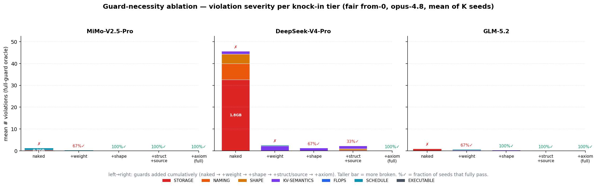

# Validation and Verification

HuggingArch publishes architecture and inference numbers that are computed, not
measured. This document states why those numbers can be trusted. The argument
has two parts:

- **Part I — Spec validation.** A spec is written by an agent. Before it is
  published it must pass a set of deterministic *gates*, each of which compares
  the spec against evidence the spec did not author (the checkpoint, the model
  config, the engine's own computation, reviewed claims). §1–§7.
- **Part II — Inference-result verification.** Given a valid spec, the
  inference numbers derived from it are checked by algebraic self-consistency
  rules, grouped into classes A–E, which reduce what a person must audit to a
  finite list of per-op axioms. §8–§14.

The spec vocabulary is defined in the [technical design](design.md); KV storage
modelling has its own [deep dive](kv_cache_storage.md).

---

# Part I — Spec validation

## 1. Deterministic anchors

### 1.1 The failure mode

Language models produce specs that look plausible but are wrong by counts: a
projection with the wrong `out_features`, a missing router gate, a
sliding-window layer wired as global. They produce them with confidence; the
agent reports completion while the spec is broken (§7 measures this). A
validator built from the same kind of judgment that wrote the spec would share
its blind spots. Validation therefore compares the spec against something it
did not author.

### 1.2 Evidence sources

1. **The checkpoint** — the safetensors headers: per-tensor names, shapes,
   dtypes and byte spans.
2. **The engine's computation** — the shapes, costs and caches the evaluator
   derives from the graph in its single walk, independent of what the author
   claimed.
3. **Reviewed claims** — `kv_growth` laws in `backend/arch/claims/components/`,
   written by a reviewer against the modelling source. A claim's `src` field is
   a citation for human review; no check fetches or verifies it.
4. **The model config** — values such as `sliding_window`, per-layer schedules
   and config-named parameters.

The modelling `forward()` source is also supplied, to the agent for
equivalence review and to best-effort source diagnostics, and as the anchor of
declared cross-layer streams (§3).

The guarantees differ in strength. Checkpoint gates compare two
representations reached on independent paths. A claims gate compares an
authored expectation with the engine's result: it catches drift between
declaration and computation, not an expectation that misreads its source. The
active-window gate checks a model-level config signal against graph
boundedness, and only for the presence of at least one bounded stream.

### 1.3 Gates and diagnostics

A **gate** contributes an entry to `errors[]`; a spec is valid iff
`len(errors) == 0`, and only valid specs are published. A **diagnostic** is
returned to the agent's refinement loop but never blocks publication (§6). The
split is deliberate: gates encode facts the tool can establish exactly; whether
a component is faithful to the module it models is a semantic judgment left to
the agent, because approximating it by searching the source for keywords is
lossy.

## 2. Pipeline and entry points

1. **Load-time hard checks** (`arch/document.py`, `arch/loader.py`,
   `arch/schema/`) reject unknown keys (`extra="forbid"`), a `per_layer.assign`
   type with no `map` entry, unresolvable `template:` references, non-forward
   or duplicate `inputs:` edges, a `tied_weight.to` naming no earlier layer,
   conflicting quant-override selectors, quant sibling tensor names in
   component YAML, and role names `roles.yaml` does not classify. These catch
   typos and broken dataflow, not architecture.
2. **Resolution.** If no spec matches, the result is
   `No spec matched for ...`, a prerequisite failure rather than a gate result.
   A config or checkpoint that cannot be fetched raises `ConfigUnavailable` /
   `CheckpointUnavailable`: that is infrastructure, not an error the writer can
   repair.
3. **Check modules** (`arch/validate/`, composed by `_orchestrator.py`;
   gate list in `_gating_errors`). A check module that raises becomes a
   `check_crashed` finding in its own list (`detail`:
   `"{label} raised {ExcType}: {exc}"`), so a crash in a gating check fails the
   gate, and a crash in a diagnostic stays a warning.
4. **Analysis replay** (§3, last row), injected by the publication entry point
   and run only when every other gate passed.

Entry points: `python -m backend.inference.validate <model_id>` is the
publication check (all gates including the replay);
`python -m backend.arch.validate` runs the arch gates without the replay, as a
diagnostic.

**The validator never blocks a novel topology.** A structure the library
cannot express is declared as a new component (an activated draft or an inline
block); the gates pass once its name resolves in the loader's library,
activated-draft or inline namespace. There is no architecture whitelist.

## 3. The publish gates

Each gate rides an ablation lever (`arch/validate/_ablation.py`, environment
variable `HA_ABLATE_GUARDS`, inert when unset) that drops both its errors and
its warnings; §7 uses these levers. Sub-levers: `weight` implies `packing`,
`structural` implies `schedule`, `axiom` implies `swa_window`.

| Gate (lever) | Anchored to | Catches | Module |
|---|---|---|---|
| Checkpoint tensor coverage (`weight`) | safetensors tensor names, shapes, dtypes | a header tensor no spec leaf claims (`unmatched_hf_tensors`); a pattern whose physical element count disagrees with its leaf (`param_mismatches`); a stored name absent from the header (`checkpoint_name_absent`) | `_matching`, `_checkpoint_names` |
| Storage bytes (`weight`) | header aggregate; the shard headers' `data_offsets` spans | weights + declared buffers ≠ `model_storage_bytes`; the spec's whole checkpoint, scales included, ≠ the files' byte spans; an unavailable byte anchor | `_orchestrator`, `eval/checkpoint.py` (`Reconciliation`) |
| Weight ledger, tied copies (`weight`) | each stored weight's `weight_axes`; `tied_weight` declarations | a stored weight the per-rank ledger cannot place or price; a tied copy the checkpoint stores but the spec does not declare, or the reverse | `_weight_ledger`, `_tied_copy` |
| Packing / scheme consistency (`packing`) | per-tensor shape and dtype | a packed layout or scale-sibling dtype contradicting the scheme; an override selecting no tensor (`quant_override_unused`); an unregistered `quant_method` that `quant_context` does not describe (`quant_method_unknown`); an override whose `method:` names a tensor the scheme does not describe; two nodes of one role in one stack stored at different precisions, in prefill or decode form (`quant_role_mixed_precision`, naming the finer role to declare; one node stored differently across its own layers is instead declared with a layer-scoped override, `quant_context.overrides[].select.layers`); a tensor the decode form resolves to a different format than prefill (`quant_phase_format_mismatch`) | `_packing_consistency` |
| Claims, active window, attention variant (`axiom`) | `kv_growth` claims vs. the cache each call grows; active `config.sliding_window` vs. graph boundedness | wrong KV-growth class (`axiom_kv_violation`); a windowed config modelled entirely as dense (`windowing_declared_but_unmodelled`); DSA ops or `kda_layers` without `attn_variant` (`attn_variant_missing`); a model whose analysis fails (`axiom_unjudged`) | `_axioms` (§5.1–§5.2) |
| Sliding-window contract (`swa_window`) | each call's `cache.family` and the stored lengths of its cache | a windowed-family call with an uncapped growing tensor, or none that grows (`swa_cache_unbounded`) | `_axioms` (§5.3) |
| Selection reads (`axiom`) | a score read through a `select` operand | a cached tensor read through a selection whose read law declares no bound (`selected_read_unbounded`) | `_selection_reads` |
| Cache declaration completeness (`axiom`) | each reachable attention-kind component's `cache` declaration | no `cache.family`; on the decode path, neither per-token `cache.entries` nor a recurrent `state:` | `_type_contracts` |
| Schedule and config-named parameters (`schedule`) | per-layer `config_list` values; `ParamSpec.config` | a per-layer schedule leaving layers uncovered; a parameter not bound to the value the config names (`param_config_mismatch`) | `_schedule_exhaustiveness`, `_activation` |
| Shape / dataflow (`shape`) | op shape and DimMap contracts | tensors whose ranks or dimensions do not compose | `_shapes`, `arch/axis_propagation.py` |
| Rotary sections (`structural`) | `mrope_section` / `xdrope_section` | text rotary sections contradicting the config (`rotary_position_mismatch`) | `_rotary_positions` |
| Attention masks (`structural`) | each mask-reading node's `is_causal` / `is_chunked` | an encoder attention that does not state its mask (the causal default prices its full matrix at half); score, softmax and apply of one attention stating different masks; a bidirectional band with even `s_window` | `_attention_masks` |
| Stored parameters without a reader (`structural`) | the program's edges (`in:`, `inputs:`, stream reads, `tied_weight:`); `stored_without_graph_reader: {kind, reason, source_anchor}` with `kind` ∈ {`forward_unread`, `unmodelled_reader`} | a lookup table (other than the input embedding) or parameter source that no edge reads and that does not declare why (`unread_lookup_table`, `unread_stored_parameter`); a declaration on a node that is read (`stored_without_graph_reader_is_read`) or is not a parameter (`stored_without_graph_reader_not_a_parameter`) | `_unread_parameters` |
| Cross-layer streams (`source`) | declared inner and appended streams; the `src` anchor in the forward source; the producer node's evaluated shape | a stream with no producer or reader; a read of an undeclared stream; an anchor absent from the source; a declared width disagreeing with its producer; a `reads_from` refusal raised when the IR is built (`spec_tree.build._StreamTable`) | `_cross_layer_channels` |
| Layout dispatch, weight identity (`analysis`) | the layout walk's dispatch for every reached op, prefill and decode; the per-rank weight join at one GPU | an op no layout law places; one block template bound by two live model layers of one stack; a spec with no `d_model` / `n_vocab` | `_analysable` |
| Analysis replay (`analysis`; publication entry point only) | the product's `estimate_capacity` (prefill and decode) on one GPU, TP, EP with DP-attention (plus an `ep8 + dp8` audit deployment for dense models) and CP under each scheme the cache allows, each at its highest legal degree up to 8, each passing the SOL closure (§10); engine-only (`framework_bindings.THEORY`); memoised by spec, config and engine | a spec refusal naming declaration and fix (`analysis_refusal`); an engine gap for a correctly stated construct (`analysis_engine_refusal`; `blocked_by_engine` when every error is one); a refusal whose raise site declares neither (`analysis_refusal_unattributed`) | `backend/inference/analysable.py` |

Pipeline parallelism is not replayed: a spec declares nothing about it, and a
stage is placement arithmetic over the occurrences the `pp = 1` walk resolves.

## 4. The checkpoint anchor

### 4.1 Per-tensor join, then byte checksums

The primary weight gate is per tensor: every header tensor must be claimed by a
spec leaf and agree with it in physical elements, and every name the spec
stores must exist in the header. Storage bytes follow as checksums on that
join — weights plus declared buffers against `model_storage_bytes`, and the
whole checkpoint including scale siblings (`Analysis.iter_checkpoint()`)
against the byte spans the shard headers record. A sum catches a wrong width
but not two submodules swapped with the same total, which is why it is
secondary.

Bytes, not elements, are compared because bytes are the only unit that needs no
conversion in a mixed-precision checkpoint (for example FP4 routed experts, FP8
attention and BF16 norms in one file). The total element count is reported as a
diagnostic, reliable only for single-precision checkpoints.

### 4.2 Names carry structure

- **Topology.** `model.layers.X.self_attn.q_proj.weight` is a model root
  (`model.`), a stack address with index (`layers.X.`), and a module path
  (`self_attn.q_proj`). The spec declares the first two (`checkpoint: {root}`;
  the stack's name or `checkpoint: {prefix}`), its node names spell the third,
  and each stored name is composed once from those declarations
  (`spec_tree.compose_module`).
- **Quantization.** Names and dtypes encode the scheme (a `qweight` tensor is
  GPTQ/AWQ 4-bit packing; a `_scales` sibling at UE8M0 is MXFP4 block
  exponents). The scheme itself comes from the spec's `quant_context`; the
  validator never parses `config.quantization_config` (see
  [quantization](quantization.md)).

### 4.3 Matching

Matching is an exact join on the full tensor name (`CheckpointJoin`), read in
both directions: header tensors no stored name selects are
`unmatched_hf_tensors` (typically a forgotten router gate or expert bias);
stored names selecting nothing are `checkpoint_name_absent`. Header names are
taken verbatim (`hf.header.SafetensorsHeader`). A spec name writes `X` at each
indexed position and literal segments elsewhere, and selects every header
tensor that agrees at the literal segments. Several stored tensors may share a
name (an `input_layernorm` in both dense and MoE templates; an MTP layer in the
backbone's index space); the per-pattern diagnostic sums them before comparing,
so a missing one appears as a count mismatch.

## 5. Facts the weights do not anchor

The byte anchor sees everything written to disk and nothing about use at
inference time: how many past positions a query attends to, whether a cache is
bounded, which nodes are cached. A sliding-window attention and a global
attention with the same head dimensions have byte-identical weights. A windowed
layer wired as dense caches the whole sequence, and its per-request KV grows by
orders of magnitude at long context with nothing in the parameter count to
reveal it.

The gates below cover this blind spot. All read one analysis of the whole model
(`Deployment(Program.of(resolved)).at(batch=1, input_tokens=1).analyze()`). They
are also the implementation of the class D type contracts of Part II (§12).

### 5.1 Attached claims (`_axioms`)

Claims live only in `backend/arch/claims/components/<identity>.yaml`
(`schema: huggingarch.claims/v1`, `subject` = component identity). The loader
(`spec_parsing._attach_claims`) attaches them by identity to the standalone
component or model-inline block of that name; an `axioms:` key in a component
YAML, draft or inline block is a load error. Each claim is a `kind: kv_growth`
law with fields `node`, `expect`, `storage` (`per_token`, `windowed`,
`constant_state`), `bound` and `src`.

The check visits every component call in the program, reads the cache that call
grows (`cache.by_call`), and judges its claims in that call's dims
(`analysis.node_dims`). In a parent's cache a nested child's tensors carry its
name as a prefix (`indexer.compressor.pooled_out`); the child's own call uses
its own names (`compressor.pooled_out`). Boundedness is decided by substituting
`s_kv → ∞` into the stored-length expression, so any composition (`Min`,
`ceiling(s_kv/r)`, a top-k) is judged without pattern matching. `windowed`
requires a length that caps, `per_token` one that grows, `constant_state` one
free of `s_kv`. Further rules:

- per-layer dim variants are judged at each call;
- a template-bound copy reports under its source component;
- a block a stack runs directly as `template:` is judged and holds no cache of
  its own;
- a component the model never calls is not judged;
- `decode_variant` forms are judged on the decode phase's analysis
  (`Deployment.during("decode")`) under their own name;
- if the model analysis fails, a single gating `axiom_unjudged` carries the
  error.

Claims anchor **library** components. A spec writer authors no claims; it
expresses windows, compression and constant state in the graph
(`sliding_window_kv`, `state:` under `cache.entries`), and validation judges the
cache the graph produces.

### 5.2 Active-window config (`_axioms`)

If `config.sliding_window` is a positive integer, `use_sliding_window` is not
`false`, and the model calls at least one attention-kind component
(`roles.kind_of(role) == "attention"`) that persists a cache, at least one such
call must keep a cached tensor that grows and is bounded; otherwise
`windowing_declared_but_unmodelled`. A model that does not use the field opts
out with `validation_exemptions.sliding_window` and a reason. This is a
model-level presence check, not proof that every windowed layer is modelled
correctly; it is skipped when no such call exists.

### 5.3 Sliding-window contract (`_axioms`, lever `swa_window`)

In a call whose `cache.family` is in the windowed family, every cached tensor
that grows with the sequence must cap, and at least one must grow; otherwise
`swa_cache_unbounded`. The window is expressed in the graph (a
`sliding_window_kv` over the stream's `cache.entries`, with the model's window
as `s_window`), so no claim is authored for it. The check reads stored cache
lengths, not FLOPs: a windowed and a global layer emit structurally identical
attention FLOPs, so a `has(Min)` predicate on the FLOPs expression would
false-positive on every windowed component.

### 5.4 Selection reads and attention variants

A cached tensor read through a `select` operand must declare how many positions
it reads (`_selection_reads`, `selected_read_unbounded`). A layer using DSA ops
or `kda_layers` must say so in `attn_variant` (`attn_variant_missing`).

### 5.5 Cache precision (diagnostic only)

No gate covers the precision at which a cache slot is stored: the cache is
runtime state and no checkpoint byte records its format. A reference forward
often quantises a write and copies it into a buffer allocated at the model
dtype; a spec that models the buffer instead of the write bills an FP4 slot as
BF16 and passes every gate. The cache-write scan (`_cache_writes`) reads the
forward source: each write into a registered buffer that a quantising call
reached first asks the as-shipped walk for a per-token slot at that format (the
element width the call's name states, such as `fp4_act_quant`; a quantised slot
if it states none; an `unquantized_tail` if a slice was quantised). Buffer names
key nothing in the spec, so it matches by format and reports
`cache_write_quantised_unmodelled` as a non-gating source warning.

## 6. Diagnostics and the refinement loop

Gate failures and diagnostics are both returned to the agent in structured
form; only gates block. Diagnostics are: forward-source equivalence hints
(`_structural`, including a stream whose source anchor went unchecked because
no forward source is recorded), the cache-write scan (§5.5), module execution at
small configs (`_module_exec`), FFN activation and router scoring against the
config, parameter counts against the model card (`_model_card`), the logical
element-count diff (§4.1), and reuse between drafts (`_reuse`).

Draft reuse stays a diagnostic because a high overlap does not prove a legal
remedy exists: the writer cannot edit `library/` or `adapters/`, so a draft that
restates a library component whose fixed parts it must not carry has nothing to
bind instead. The same comparison is available before authoring:
`python -m backend.arch.component_reuse <component.yaml>` ranks existing
components of the same `role:` by the share of their edges the candidate holds
(`arch/component_reuse.py`). Roles are compared, not ignored: a `role: block`
contains an attention and so holds nearly every edge of any attention graph,
which is composition, not a copy.

**Engine gaps.** Every refusal goes back to the writer as an error to repair,
except an engine gap. When every remaining error is an
`analysis_engine_refusal` (`blocked_by_engine`), the spec is complete and the
run stops. The run's `done` event and log row carry
`error_kind: blocked_by_engine` and the gaps (`engine_gap_entries`: capability,
node, raise site, deployments, stages). A signed-in run keeps the spec as the
user's pending `blocked_by_engine` record, beside and never over valid records;
the Inspector serves it only when no valid record exists, with a banner naming
each gap. A manual re-check reruns validation on the saved bundle: a pass
promotes the record to the working candidate; errors the writer can resolve move
it to `needs_repair`. Statuses and error kinds form one closed vocabulary
(`spec_worker/outcome.py`), held equal to the SQL CHECK constraints and the
frontend badge table by `tests/meta/test_generation_vocabulary.py`.

## 7. Evidence: guard-ablation study

This section summarises an **archived measurement**. It was taken against an
earlier validator revision, and its harness is not in the repository; the
results are evidence for the design, not a verified property of the current
gate set.

### 7.1 Method

Two experiments asked whether each guard is necessary.

1. **Deterministic unique coverage.** Inject into a known-correct spec the
   corruption a guard defends against, then run the full validator and record
   which guards catch it.
2. **From-scratch agentic ablation.** A spec-writer agent regenerates each model
   from scratch in a de-contaminated sandbox: the target's own components, all
   model-characteristic components, all other specs and snapshots, fusion plans
   and model-specific primitive ops are removed, leaving a generic
   building-block kit, primitive ops and the target's forward source, config and
   tensor names. A post-run scan of git history, network access and absolute
   paths found no escape. Guards are added cumulatively through the levers of
   §3 — `naked → +weight → +shape → +structural/source → +axiom` (full) — with
   three seeds per cell. The oracle is the full validator run over the produced
   spec.

### 7.2 Results

- **Unique coverage.** In the measured revision, each target guard was the sole
  catcher in all 14 live cells.
- **Agentic ablation.** With no guards, all three models were 0 % valid; with
  all guards, all three were 100 % valid. Each guard removed its own error
  class as it was enabled: `weight` removed storage errors (DeepSeek-V4-Pro,
  a 1 T-parameter Hyper-Connections model: 32.7 → 0 mean violations, 1.8 GB of
  storage discrepancy → 0), `shape` removed shape errors, `schedule` removed
  schedule errors, and the claims and sliding-window contract removed the
  remaining KV-semantics errors, which persisted on DeepSeek-V4-Pro and GLM-5.2
  until the full tier.

  | Model | No guards | All guards |
  |---|---|---|
  | DeepSeek-V4-Pro (Hyper-Connections, MoE) | 0 % valid; mean 32.7 storage + 7.3 naming + 4.3 shape + 1.3 KV violations | 100 % valid |
  | GLM-5.2 (MLA + DSA + MoE) | 0 % valid; storage | 100 % valid |
  | MiMo-V2.5-Pro (SWA, fused QKV) | 0 % valid; storage + schedule | 100 % valid |

  

  The intermediate tiers are not monotone for DeepSeek-V4-Pro (1.3 violations
  and 67 % valid at `+shape`, 2.2 and 33 % at `+structural/source`); the
  endpoints are.
- **Confident wrong answers.** In the un-guarded cells the agent exited with
  `success=True` and its own (ablated) validation passing, while the oracle
  found the spec broken. The gap between what the agent saw and the truth is
  the guard's contribution. Necessity grew with the difficulty of the
  architecture: DeepSeek-V4-Pro cost roughly 3–4× the agent turns, tokens and
  wall time of the other two models.
- **Oracle check.** A structural comparison against the committed spec
  (engine-computed parameters, bytes, per-block profile and KV semantics)
  agreed with the oracle on clear cases; where they diverged, the oracle caught
  more (schedule coverage and tensor naming, which a parameter comparison does
  not see).

### 7.3 Limitations

- The fault injector targets cache attributes and a diagnostic kind that no
  longer exist, so the unique-coverage matrix cannot be reproduced without
  migration. It is also no longer true as stated: the active-window gate (§5.2)
  now overlaps the sliding-window contract for MiMo-V2.5-Pro, whose config
  declares `sliding_window: 128`.
- Three seeds per cell report rates, not single draws; run-to-run compute
  varied with a coefficient of variation of about 12–16 %.
- The comparison against the committed spec is a numeric and structural
  signature, not op-graph isomorphism.
- Sandbox isolation relied on de-contamination and a post-hoc scan, not
  OS-level isolation.
- Three models were measured; the result is not proof that the gate set is
  complete for every model or fault.

The levers (`HA_ABLATE_GUARDS`) and op stripping (`HA_STRIP_OPS`) remain in the
code and are inert when unset.

---

# Part II — Inference-result verification

## 8. Principle

Inference numbers cannot be checked by hand across models and configurations.
Instead, a person audits a small, finite set of per-op axioms once (class A),
and algebraic rules that need no knowledge of the correct constants check
everything composed from them (classes B–E).

A cross-check verifies only the logic its two paths do **not** share, and a
top-down closed form for absolute attention FLOPs is unreliable under hybrid
attention. The main verification therefore comes from conservation,
perturbation invariants and type contracts, not from computing a number twice.

The classes are grouped by how a person reviews them:

| Class | Rules | What a reviewer confirms |
|---|---|---|
| A | per-op, single-layer cost axioms | the formula against source, once |
| B | conservation identities | the partition is exhaustive and disjoint |
| C | perturbation invariants | the relation must hold physically or algebraically |
| D | type contracts | the declared type implies the structural predicate |
| E | dual-path cross-checks | the two paths are independent, and what they share |

Implemented B and C rules run in the invariant battery
(`backend/inference/invariants.py`; `python -m backend.inference.invariants
<model_id>`, default deployment TP 1 / CP 8 / EP 8 on B200 at 65 536 input
tokens) and in the tests cited below. The battery reports each result with its
class and prints `passed/total`; the number of results varies by model. Rules
marked *not implemented* provide no coverage and must not be counted.

## 9. Class A — axioms

**Definition.** The cost formula of each primitive op for one layer: shape
inference, compute (FLOPs and access) and KV (what is cached and how large).
This is the only part of the system that cannot verify itself: whether a
windowed layer costs `s_ctx·s_window` or `s_ctx²`, or whether the DSA indexer
caches 128 or 64 values per token, is a matter of definition. A wrong axiom can
be caught only by review against source; this is the deliberate trust
boundary.

**Location.** `backend/arch/ops.py` (primitive FLOPs and shape laws) and
`backend/arch/eval/cache.py` (per-tensor KV storage and read laws); component
KV laws as claims (§5.1).

### 9.1 Inventory

| Axiom | Formula | Pinned by |
|---|---|---|
| qk_score | `2·B·n_heads·s_query·s_kv·d_head·causal` | review |
| attn_apply | `2·B·n_heads·s_query·s_kv·d_head_value·causal` | review |
| linear / dense | `2·B·s_ctx·in·out` | review |
| routed MoE expert | tokens = `B·s_ctx·n_experts_active/n_route_targets` (the denominator counts routing destinations, including zero-compute slots); per expert `2·tokens·d_ffn_expert·d_model` | review |
| SWA read clamp | `min(s_window, s_kv)` | review |
| MLA KV per token | `(d_kv_lora + d_qk_rope)·bpe` | claim on `mla_attention` |
| DSA indexer KV per compressed position | width `d_indexer_head` (128); `n_indexer_heads` (64) counts query heads and does not fan out the MQA cache | `tests/backend/arch/validate/test_axioms.py::TestAxioms` substitutes `n_indexer_heads` and requires `axiom_kv_violation` |

### 9.2 Anchoring procedure

Shape is the foundation: FLOPs and KV both read shapes, so a wrong shape makes
both wrong. To anchor an op or component (prefer new structures, the least
validated):

1. **Read the source on all three axes** — the model's modelling code
   (`$HA_VLLM_SRC`, `$HA_SGLANG_SRC`, or the model's own `model.py`), not a
   paper. Example: the DeepSeek-V4 indexer's
   `einsum("bshd,btd->bsht", q, kv_cache[:, :end_pos//ratio])` makes the key
   axis the compressed count `s_kv/compression_ratio`, and
   `kv_cache=zeros(B, S//ratio, index_head_dim)` a 128-wide MQA cache.
2. **Compute one layer by hand.**
3. **Compare with the engine** — dump its shapes, FLOPs and KV
   (`kv_cache_topology`; `backend/arch/structure.py` lays out the compiled
   structure) and diff each axis.
4. **Fix at the right abstraction** — the op's DimMap or a general mechanism,
   never a per-model case. Source, not documentation, is ground truth.
5. **Pin with a unit test** that asserts the derived value and quotes the source
   expression in a comment (see `test_axioms.py::TestAxioms`), and, for KV laws,
   a claim beside the library component (§5.1). The test does not read the
   source; a person reviews the citation.
6. **Run the battery** (§8) and confirm key quantities (for example KV per
   token) match expectations.

## 10. Class B — conservation

**Definition.** A whole equals the sum of its parts, with no overlap and no gap.
These identities do not depend on any cost being correct.

| Rule | Assertion | Implementation |
|---|---|---|
| Tree closure | every node: `Σ children == parent` (FLOPs, params, bytes) | by construction: traffic parents are summed from children in `backend/arch/eval/traffic.py` (`derive`); no separate check |
| FLOPs closure | breakdown table, per-op rows and step FLOPs agree | `invariants._inv_flops_closure`, relative tolerance `1e-9` |
| Phase closure | `Σ per-op time == phase t_sol`, including draft-model rows under speculative decoding and the per-stage bound under pipeline parallelism | `invariants._inv_phase_closure`, relative tolerance `1e-9`; skipped when time is not published |
| Traffic partition | each leaf's access == weight read + metadata + input activations + output activations + quantisation casts | `invariants._inv_traffic_partition`, exact integers; also enforced on every replayed deployment by `backend/inference/sol_closure.py` (§3), together with per-phase sums of FLOPs, access and write bytes |
| Layout closure | every state change corresponds to one collective | `tests/backend/arch/layout/test_eval_placement_diff.py::TestClosure` |
| Communication closure | per-rank collective bytes == shape × dtype × algorithm factor | `tests/backend/inference/test_parallelism_comm_volume.py::TestCommVolumeInvariantSweep::test_every_comm_row_matches_closed_form` (the decode DCP LSE all-gather is an explicit exception) |
| Memory total | `groups + model_level + fused + unmatched == deployment_total` | `tests/backend/inference/test_inference_data_invariants.py::TestMemoryAggregationFrontendContract::test_deployment_total_matches_four_term_decomposition` |

MoE weight reads saturate at `min(demand(B), weight_total)`, and routed rows use
the busiest rank's row count (`ep_load_factor`).

**Blind spot.** Two wrong sub-terms that cancel exactly.

## 11. Class C — perturbation invariants

**Definition.** For one architecture and configuration, change one input; the
outputs must satisfy a relation stated in advance. This tests the response
signature, not absolute values, so it holds under hybrid attention. There is no
fitting and no sampling.

| Perturbation | Must hold | Implementation |
|---|---|---|
| `B → 2B` | forward FLOPs exactly ×2; params unchanged | `invariants._inv_batch_linearity` (walk-level, exact integers) |
| `cp_scheme: ulysses → pcp` | per-op per-rank FLOPs equal; per-rank activation access differs only by each op's fixed axis ratio (query identical, KV ×cp under pcp, per-token ops without a head axis 1/cp); 2 % relative tolerance | `invariants._inv_cp_scheme`; `tests/backend/inference/test_perturbation_invariants.py::TestCpSchemeInvariantActivation::test_the_schemes_agree_where_they_must` (DeepSeek-V3 / V3.2 / V4-Pro, `cp = 8`) |
| homogeneous group `count → count − 1` | total decreases by exactly one layer of that group | not implemented |
| global group `s_ctx → 2·s_ctx` | qk_score exactly ×4 | not implemented (class D checks KV growth structure, which is not equivalent) |
| windowed group `s_kv: s_window → s_window + Δ` | read term unchanged (saturated) | not implemented (class D checks boundedness, not this relation) |
| `TP = 1 → TP = k` | shardable parts exactly `/k`; communication grows by the collective factor | not implemented |

**Blind spot.** A wrong axiom: composition is verified, single-layer cost is not.

## 12. Class D — type contracts

**Definition.** A declared type (`cache.family`, `attn_variant`), an active
`config.sliding_window`, or a reviewed `kv_growth` claim implies structural
features of the engine's derived cache. This is the primary defence for hybrid
attention, and it is implemented by the spec gates of §5; the mechanics are
specified there and not repeated here.

| Declaration | Predicate | Gate |
|---|---|---|
| attention-kind component | declares `cache.family`, and on the decode path per-token `cache.entries` or a recurrent `state:` | `_type_contracts` (§3) |
| `storage: per_token` claim | the claimed tensor's stored length grows with `s_kv` at every call | `axiom_kv_violation` (§5.1) |
| `cache.family` in the windowed family | every growing cached tensor caps; at least one grows | `swa_cache_unbounded` (§5.3) |
| active `config.sliding_window` | at least one cached attention call keeps a growing, bounded tensor | `windowing_declared_but_unmodelled` (§5.2) |
| `storage: constant_state` claim (linear / SSM) | no cached tensor's stored length has a free `s_kv` | `axiom_kv_violation` (§5.1) |
| MLA claim | KV per token `== d_kv_lora + d_qk_rope` elements | `axiom_kv_violation` (§5.1) |
| selection read | the read law declares a bound | `selected_read_unbounded` (§5.4) |
| MoE | active expert cost scales with `n_experts_active/n_route_targets` | none: router reviewed by a person; structural diagnostics only |

Predicates are stated on stored cache lengths, not on `flops_expr.has(Min)`
(§5.3).

**Blind spot.** A mislabelled declared type, and wrong axiom constants (A).

## 13. Class E — dual-path cross-checks

**Definition.** The same quantity computed along two independently implemented
paths. A cross-check verifies only the logic its paths do not share; each must
state its shared upstream, which it does not cover.

| Quantity | Path 1 | Path 2 | Shared / caveat | Status |
|---|---|---|---|---|
| dense / MLP FLOPs | graph-walk Σ | `2·P_active·T` | same structure | no mechanical check |
| KV bytes per token | emitted per node | symbolic per-group sum | both read the resolved spec | no mechanical check |
| absolute attention FLOPs | graph walk | top-down closed form | closed form unreliable under hybrid attention | retired; replaced by C and D |

**Role.** A disagreement between E paths flags an unresolved axiom; it does not
decide which side is right. For example, if emitted and symbolic indexer KV
disagreed (64 versus 128 per position), the resolution is a class A review of
the source.

## 14. Residual risk

Without measurement, class A axioms cannot verify themselves, and the
unimplemented B, C and E rules leave further gaps. For the implemented rules the
system isolates the trust boundary into a finite list a person can audit once,
and checks compositional relations within its coverage. It does not yet reduce
all compositional risk to that list.

---

## Appendix — Code map

| Concern | Location |
|---|---|
| Gate composition, gate list | `backend/arch/validate/_orchestrator.py` (`_gating_errors`) |
| Ablation levers | `backend/arch/validate/_ablation.py` |
| Tensor join, both directions | `_matching.py`, `_checkpoint_names.py` |
| Bytes vs checkpoint | `_orchestrator.py`, `backend/arch/eval/checkpoint.py` (`Reconciliation`), `Analysis.iter_checkpoint()` |
| Weight ledger, tied copies | `_weight_ledger.py`, `_tied_copy.py` |
| Quant packing | `_packing_consistency.py` |
| Claims, active window, sliding-window contract | `_axioms.py`; claims in `backend/arch/claims/components/` |
| Cache declarations | `_type_contracts.py` |
| Selection reads | `_selection_reads.py` |
| Schedule, config-named params | `_schedule_exhaustiveness.py`, `_activation.py` |
| Shapes | `_shapes.py`, `backend/arch/axis_propagation.py` |
| Rotary sections, masks | `_rotary_positions.py`, `_attention_masks.py` |
| Stored parameters without a reader | `_unread_parameters.py` |
| Cross-layer streams | `_cross_layer_channels.py` |
| Layout dispatch, weight identity | `_analysable.py` |
| Analysis replay | `backend/inference/analysable.py`; CLI `backend/inference/validate.py` |
| SOL closure | `backend/inference/sol_closure.py` |
| Diagnostics | `_structural.py`, `_cache_writes.py`, `_module_exec.py`, `_model_card.py`, `_reuse.py` |
| Load-time hard checks | `backend/arch/document.py`, `backend/arch/loader.py`, `backend/arch/schema/` |
| Invariant battery | `backend/inference/invariants.py` |
